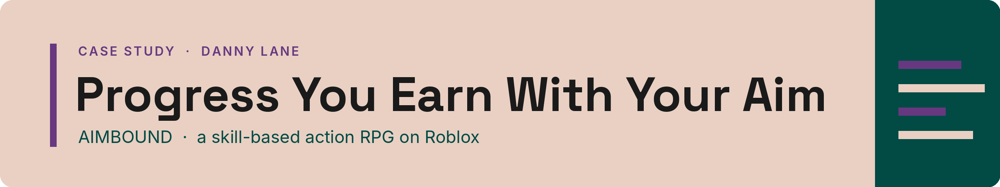
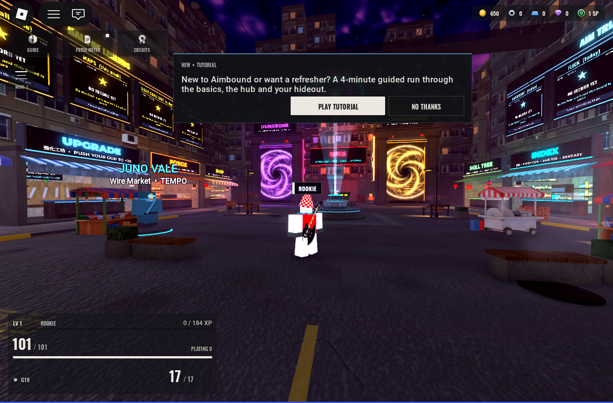
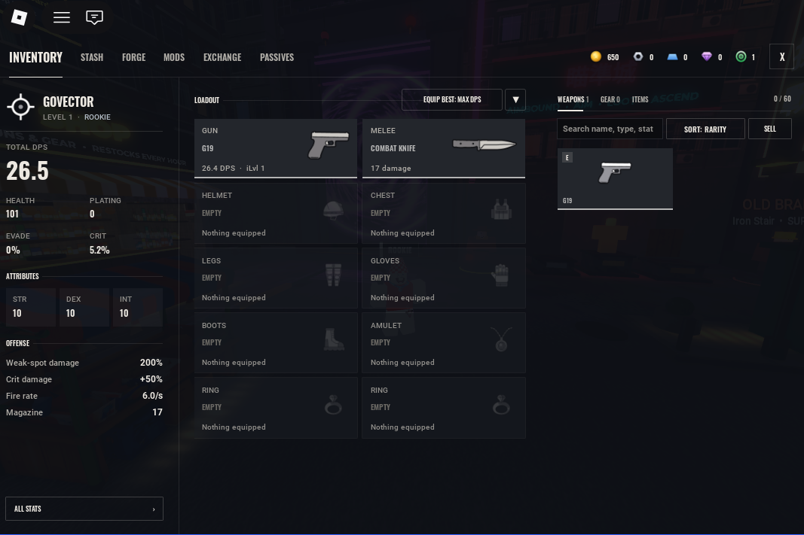
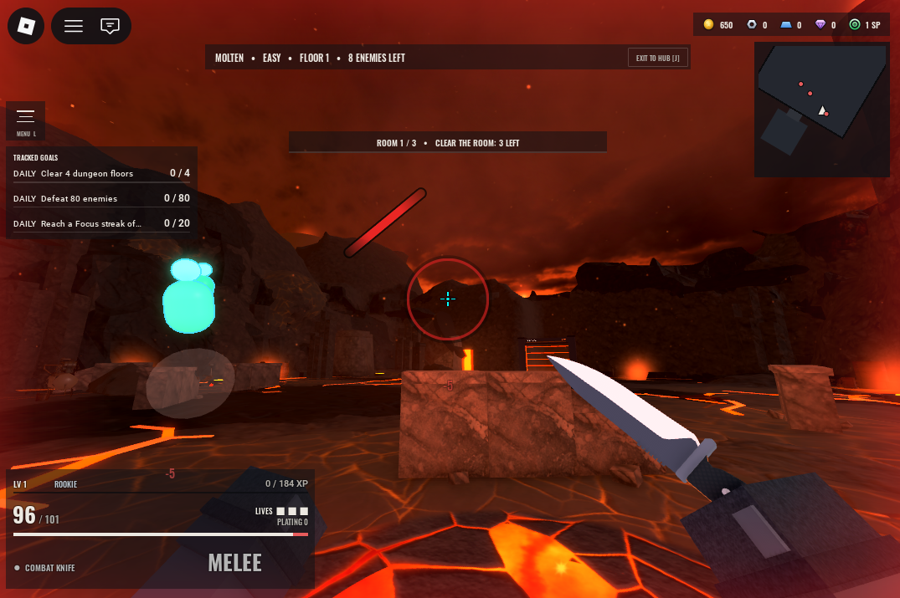

  

  
  

## **Objective**

AIMBOUND is an independent project to design and build a skill-based action RPG on Roblox. My goal was a game where progression rewards player precision rather than time spent, with procedurally generated content that keeps each session different.

I also used the project to practice large-scale systems architecture, data-driven design, and performance optimization outside of coursework.

## **Synopsis**

AIMBOUND combines two genres. Its enemy and skill systems are modeled on *Path of Exile*, while its aiming and movement are tuned to feel like aim trainers such as *KovaaK's* and *Aimlabs*. Procedural generation lets the content scale almost endlessly.

## **Process**

1. **Architecture first.** I designed and scripted the core systems in Luau before any visual work: a rule-based item and stat generator, procedural level generation, combat, and a data-driven skill tree.
2. **Testing and debugging.** Early playtests revealed broken world interactions and frame-rate drops. I traced the causes and resolved both before adding new content.
3. **Performance optimization.** I profiled and reduced runtime overhead so the game stays responsive with many enemies and effects on screen.
4. **Balancing.** I adjusted the progression economy (currency and leveling curves) based on playtest feedback so rewards feel earned.
5. **Third-party integration.** I integrated an existing weapon framework while keeping my own stat and combat systems in control. I also planned a custom set of about 20 weapons with original models, animations, and visual effects.
6. **AI-assisted development.** I built AIMBOUND with AI-assisted development, using Claude Code connected to Roblox Studio and Blender through MCP servers. I directed the game design and systems architecture, and handled the testing, debugging, and balancing, while the AI tooling wrote much of the code and sped up the move from 3D modeling to in-engine scripting.

## **Results**

AIMBOUND is in active development as a self-directed project. The core gameplay loop is functional, including procedural levels, randomized loot, combat, and the skill-tree framework. Current work focuses on the custom weapon set, movement refinement, and enemy AI.

**Skills demonstrated:** systems architecture, Luau scripting, procedural generation, data-driven design, performance profiling, playtest-driven iteration, a Blender 3D asset pipeline, and AI-assisted development tooling.

## **Code**

The game's 318 Luau scripts are in [`src`](src), organized by system to match Roblox Studio's services. Art, audio, and 3D assets are not included.

| Folder | What's inside |
|---|---|
| [`src/ServerScriptService`](src/ServerScriptService) | Server logic: combat, dungeon runs, saving, parties, trading, and anti-cheat checks |
| [`src/ReplicatedStorage/AimRngShared`](src/ReplicatedStorage/AimRngShared) | Shared modules: item and stat generation, the skill tree, procedural rooms and biomes, enemy and boss AI, and UI |
| [`src/StarterPlayer/StarterPlayerScripts`](src/StarterPlayer/StarterPlayerScripts) | The client: input, movement, HUD, and menus |
| [`src/ReplicatedFirst`](src/ReplicatedFirst) | Loading screen |

Good places to start: [`DungeonGenerator`](src/ReplicatedStorage/AimRngShared/DungeonGenerator.module.lua) (procedural levels), [`StatCalculator`](src/ReplicatedStorage/AimRngShared/StatCalculator.module.lua) (item and stat math), [`SkillTreeData`](src/ReplicatedStorage/AimRngShared/SkillTreeData.module.lua) (the passive tree), and [`MovementController`](src/ReplicatedStorage/AimRngShared/MovementController.module.lua) (movement feel).

## **Project Photos**

*The hub players spawn into, with the optional tutorial prompt.*

*Inventory menu: character stats, equipment loadout, and weapon stash.*

*The Molten biome mid-combat, with the HUD, minimap, and daily goals.*

---

<a href="https://github.com/dclane5551">← Back to Danny Lane's profile</a>

